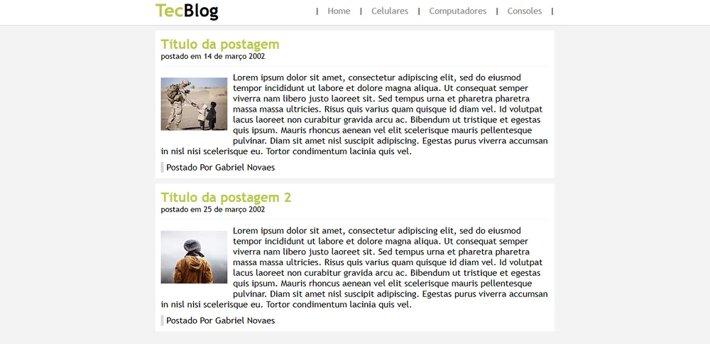

<div align="center">

# TecBlog

**Layout de um blog de tecnologia feito com HTML e CSS, um dos meus primeiros projetos web**


</div>

<br>



## Sobre

Página estática que reproduz a estrutura clássica de um blog: cabeçalho com logotipo e menu de categorias (Celulares, Computadores e Consoles) e uma lista de postagens com título, data, imagem, texto e autor. O conteúdo é de exemplo (lorem ipsum); o foco do exercício foi a marcação e o estilo.

## O que pratiquei

- Estrutura de página com HTML: cabeçalho, navegação e blocos de conteúdo
- Estilo em uma folha de CSS separada
- Layout centralizado com largura fixa e elementos flutuantes (`float`) para a imagem ao lado do texto
- Organização de arquivos em pastas (`css/` e `Img/`)

## Como abrir

Não precisa instalar nada:

```bash
git clone https://github.com/gabrielnovaesdev/Blog-tecnol-gico.git
cd Blog-tecnol-gico
start index.html   # Windows
open index.html    # macOS
```

## Estrutura

```text
Blog-tecnol-gico/
├── index.html      # Página do blog
├── css/
│   └── estilo.css  # Estilos
└── Img/            # Imagens das postagens
```

## Próximos passos

Se eu revisitar este projeto, quero deixá-lo responsivo (hoje a largura é fixa em 720 px), trocar o `float` por Flexbox ou Grid e usar tags semânticas como `<header>`, `<nav>` e `<article>`.

---

<div align="center">

Feito por <a href="https://github.com/gabrielnovaesdev">Gabriel Novaes</a> em 2023 · Veja meus projetos mais recentes no <a href="https://github.com/gabrielnovaesdev">perfil</a>

</div>
